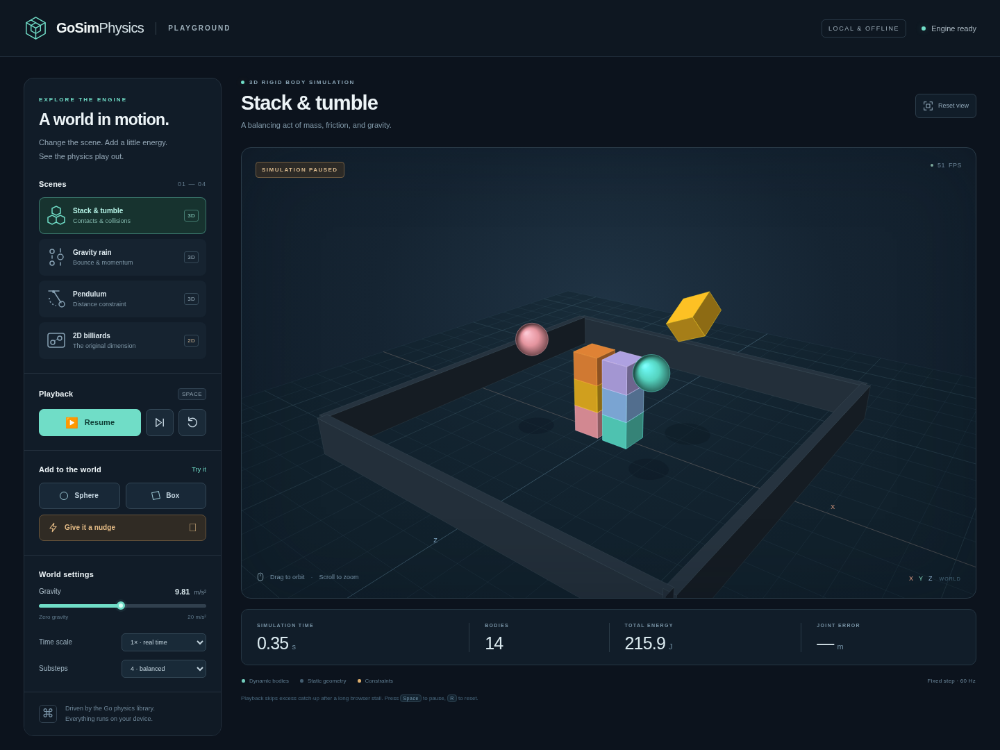
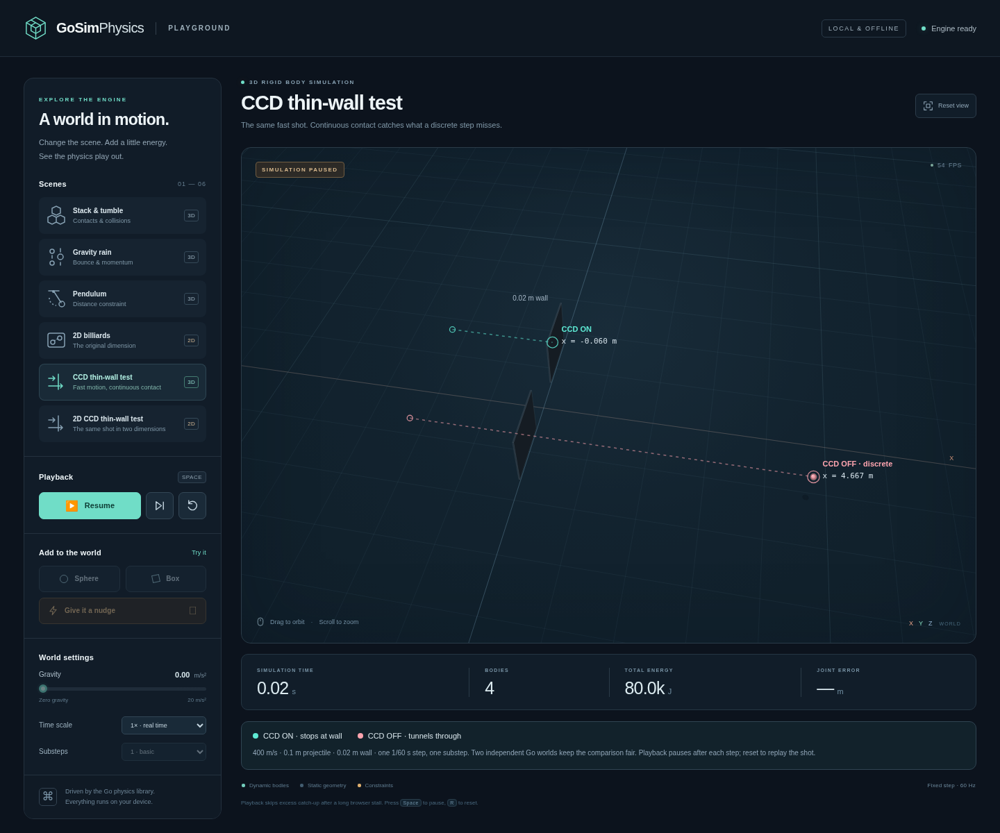

# GoSimPhysics

GoSimPhysics is a Go library for 2D and 3D rigid-body simulation in game engines.
Embed it in your game or engine; the host application owns the game loop,
rendering, input, and conversion between world units and screen coordinates.

The module path is `github.com/kyrqon/GoSimPhysics`. Requires Go 1.27 or later,
with no third-party dependencies. Import the packages you need:

| Package | Import path | Responsibility |
| --- | --- | --- |
| [`math2d`](math2d) | `github.com/kyrqon/GoSimPhysics/math2d` | 2D vectors |
| [`math3d`](math3d) | `github.com/kyrqon/GoSimPhysics/math3d` | 3D vectors and quaternions |
| [`collision2d`](collision2d) | `github.com/kyrqon/GoSimPhysics/collision2d` | Circle/rectangle geometry, contact and sweep queries |
| [`collision3d`](collision3d) | `github.com/kyrqon/GoSimPhysics/collision3d` | Sphere/box geometry, contact and sweep queries |
| [`dynamics2d`](dynamics2d) | `github.com/kyrqon/GoSimPhysics/dynamics2d` | 2D bodies, worlds, constraints, and collision response |
| [`dynamics3d`](dynamics3d) | `github.com/kyrqon/GoSimPhysics/dynamics3d` | 3D bodies, worlds, constraints, and collision response |

The package reorganization intentionally changes imports. Earlier entry points
have been removed; no compatibility facades are provided.

## Package structure

```text
math2d/       Vec2
math3d/       Vec3, Quaternion
collision2d/  Shape, Collider, Motion, Contact, TimeOfImpact
collision3d/  Shape, Collider, Motion, Contact, TimeOfImpact
dynamics2d/   Body, World, DistanceJoint, CCD response
dynamics3d/   Body, World, DistanceJoint, CCD response
examples/     Console examples and the offline browser playground
```

Each dimension has the same dependency direction. Arrows below point from a
dependency to the package that uses it; imports run in the opposite direction:

```text
math2d → collision2d → dynamics2d
math3d → collision3d → dynamics3d
```

Collision queries operate on geometry and motion without creating a world or
importing dynamics. Dynamics owns integration, forces, joints, and impulse
response. For convenience, the dynamics packages also expose aliases for their
dimension's vector, shape, and contact types, plus quaternions in 3D, so a
simulation can usually use a single import.

## Interactive browser demo



After cloning the repository, double-click
[`examples/browser/demo.html`](examples/browser/demo.html) to open the included
interactive demo. The file contains the Go WebAssembly engine, renderer, and
all assets, and works offline in a current browser. Go is not required to view
this prebuilt file.

Alternatively, with Go installed, run the example from the repository root:

```sh
go run ./examples/browser
```

Open `http://127.0.0.1:8080`. This command rebuilds the WebAssembly from the local
Go source before serving it. Use `-addr 127.0.0.1:8081` to choose another port.
This option also works with managed browsers that restrict local-file access.

The demo includes 3D stacking, mixed-shape falling bodies, a spherical pendulum,
2D billiards, and 2D/3D CCD thin-wall comparisons. Pause or single-step, spawn
shapes, apply impulses, change
gravity and substeps, and drag/scroll to orbit/zoom the 3D camera. Simulation
runs in the actual Go library; JavaScript handles rendering and controls.
The CCD comparisons run the same shot in independent worlds, with CCD enabled
in one and disabled in the other. They automatically pause after one 1/60-second
step so the actual final positions remain visible; reset replays the shot.

To regenerate the standalone HTML after changing the library or frontend:

```sh
go generate ./examples/browser
# Or export to another file:
go run ./examples/browser -export /tmp/gosim-demo.html
```

Frontend sources are in `examples/browser/web`; the Go-to-browser bridge is in
`examples/browser/wasm`. No JavaScript package installation or CDN is used.
The generated file includes the matching Go runtime; its license is reproduced
in [`THIRD_PARTY_LICENSES.txt`](examples/browser/THIRD_PARTY_LICENSES.txt).

## Implemented features

- Static, dynamic, and velocity-driven kinematic bodies.
- One centered circle or rotated box per body, with mass and rotational inertia.
- Gravity, forces, torques, impulses, linear and angular damping, and fixed rotation.
- Circle/circle, circle/box, and box/box contact detection and response, with
  restitution and Coulomb friction.
- Rigid distance joints between two body-local anchors.
- Direct contact queries through `Collide`.
- Opt-in continuous collision detection and pure `TimeOfImpact` sweep queries.

The `dynamics3d` package provides the same body, force, material, and joint concepts using
`Vec3` and `Quaternion`. It uses the full world-space inertia tensor, including
torque-free precession of anisotropic bodies. Box collision tests all 15 SAT
axes; face clipping produces up to four contacts, while edge/edge contacts use
the closest points on the supporting edges. Tangential impulses are limited to
a Coulomb friction disk, so friction behaves consistently in all directions.

The solver uses semi-implicit Euler integration, sequential contact impulses,
and positional correction. `NewWorld` defaults to four substeps, twelve velocity
iterations, four position iterations, and a restitution speed threshold of
1 world unit per second. These settings are public fields on `World`.

## Embedding the 2D library

Use consistent units: meters, kilograms, seconds, and radians. The examples use
positive Y upward, so gravity points downward. Angles increase counterclockwise.
`Box.HalfExtents` specifies half the width and half the height.

```go
package main

import (
    "fmt"
    "log"

    "github.com/kyrqon/GoSimPhysics/dynamics2d"
)

func main() {
    world := dynamics2d.NewWorld(dynamics2d.Vec2{Y: -9.81})
    ball, err := world.CreateBody(dynamics2d.BodyDef{
        Type:     dynamics2d.Dynamic,
        Shape:    dynamics2d.Circle{Radius: 0.5},
        Position: dynamics2d.Vec2{Y: 5},
        Mass:     1,
    })
    if err != nil {
        log.Fatal(err)
    }

    const dt = 1.0 / 60.0
    for range 60 {
        if err := world.Step(dt); err != nil {
            log.Fatal(err)
        }
        // Copy ball.Position and ball.Angle to your engine's transform here.
    }
    fmt.Printf("height after one second: %.3f m\n", ball.Position.Y)
}
```

## Physics tick rate and rendering

The library has no internal timer or tick-rate setting. The host chooses how
much simulated time passes by calling `world.Step(dt)`, where `dt` is in seconds.
Use a fixed positive step: `dt = 1.0 / 60.0` gives 60 physics ticks per simulated
second. Start at 60 Hz; 120 Hz can improve accuracy at a higher CPU cost.

Physics ticks are independent of rendering FPS. In a real-time host, accumulate
elapsed time, call `Step(dt)` while at least `dt` remains, and retain the remainder
for the next render frame. Bound catch-up work so a stalled renderer cannot
create an unbounded simulation backlog.

The browser example sets `const tickHz = 60` and derives `dt = 1 / tickHz` in
[`examples/browser/web/app.js`](examples/browser/web/app.js). Its speed control
scales elapsed time accumulated by the host; it keeps the physics `dt` fixed.
Regenerate the standalone HTML after editing the source to change its tick rate.

`World.Substeps` subdivides each `Step`; it does not set the host's tick rate.
With 60 Hz ticks and the default four substeps, the solver performs 240 numerical
updates per simulated second. CCD can split those substeps further at impacts.
More substeps can improve contact stability; enable `Continuous` on fast bodies
when they need swept collision detection.

## Embedding the 3D library

```go
world := dynamics3d.NewWorld(dynamics3d.Vec3{Y: -9.81})
body, err := world.CreateBody(dynamics3d.BodyDef{
    Type:     dynamics3d.Dynamic,
    Shape:    dynamics3d.Box{HalfExtents: dynamics3d.Vec3{X: 0.5, Y: 0.5, Z: 0.5}},
    Position: dynamics3d.Vec3{Y: 4},
    Rotation: dynamics3d.QuaternionFromAxisAngle(dynamics3d.Vec3{Y: 1}, 0.4),
    Mass:     1,
    Friction: 0.6,
})
if err != nil {
    return err
}
if err := world.Step(1.0 / 60); err != nil {
    return err
}
// Copy body.Position and body.Rotation to the host engine's transform.
_ = body
```

Import `github.com/kyrqon/GoSimPhysics/dynamics3d` in the surrounding Go program.
3D uses a right-handed coordinate system and world-space angular velocities,
torques, forces, and application points. Quaternions have `X, Y, Z, W` fields;
the zero rotation in a body definition defaults to identity. Other nonzero
rotations are normalized. `Inertia` returns local principal moments, and
`AngularMomentum` returns world-space angular momentum. 3D distance joints use
`Vec3` local anchors and otherwise match the 2D API.

## Collision queries without a world

Use `collision2d` or `collision3d` when you only need geometry queries. A
`Collider` contains a shape, position, and orientation (`Angle` in 2D or
`Rotation` in 3D). A `Motion` embeds a collider and adds linear and angular
velocities. These types have no body mass, forces, or world membership.

```go
package main

import (
    "fmt"
    "log"

    "github.com/kyrqon/GoSimPhysics/collision2d"
    "github.com/kyrqon/GoSimPhysics/math2d"
)

func main() {
    ball := collision2d.Motion{
        Collider: collision2d.Collider{
            Shape:    collision2d.Circle{Radius: 0.05},
            Position: math2d.Vec2{X: -2},
        },
        Velocity: math2d.Vec2{X: 400},
    }
    wall := collision2d.Motion{
        Collider: collision2d.Collider{
            Shape: collision2d.Box{HalfExtents: math2d.Vec2{X: 0.01, Y: 1}},
        },
    }
    impact, hit, err := collision2d.TimeOfImpact(ball, wall, 1.0/60.0)
    if err != nil {
        log.Fatal(err)
    }
    if hit {
        fmt.Printf("first contact after %.6f seconds\n", impact.Time)
    }
}
```

`Collide(a, b)` accepts two colliders and returns `(Contact, hit)` for their
current poses. Use `CollideChecked(a, b)` to also receive an error for invalid or
unrepresentable geometry, rather than treating it as a miss. `TimeOfImpact`
accepts two motions and a positive duration in seconds. It keeps velocities
constant, reports initial contact at time zero, and leaves the inputs unchanged.
The dynamics packages provide body-based `Collide` and `TimeOfImpact` convenience
functions. Body-based sweeps also apply static-body and fixed-rotation rules;
contact queries inspect the current geometry regardless of body type.

## Body and joint behavior

Dynamic bodies require an explicit positive mass. Static bodies stay fixed;
kinematic bodies move at their specified velocity and do not respond to forces
or impulses. Both behave as infinite mass during constraint solving. A body's
shape is copied at creation and cannot be replaced. `FixedRotation` disables
angular motion and response.

Forces and torques accumulate until the next successful `Step`, act throughout
all its substeps, and are then cleared. Apply a continuous force again before
each `Step`. `ApplyForceAtPoint` and `ApplyImpulse` take world-space application
points; off-center applications can change angular motion. Impulses change
velocity immediately. Check the errors returned by body creation, force and
impulse methods, joint creation, and `Step`.

Restitution must be between zero and one; friction and damping must be
nonnegative. Zero values mean no bounce, no friction, and no damping. Contacts
use the larger restitution and the geometric mean of the two friction values.
The restitution threshold suppresses bounce at low relative approach speeds.

A distance joint requires distinct bodies belonging to the same world, at least
one dynamic body, and an explicit positive `Length`. Anchor offsets use each
body's local coordinates; zero offsets attach at the centers. The joint can
both pull and push. Connected bodies do not collide unless `CollideConnected`
is true. `Anchors` returns their current world positions; compare their distance
with `Length` to inspect constraint error. `RemoveBody` also removes its joints.

## Continuous collision detection (CCD)



Set `Continuous: true` on a fast body's definition in either dynamics package.
The flag can also be changed on an existing body between steps. A pair uses CCD when
either body has it enabled and at least one body is dynamic; joint collision
filtering still applies. Other pairs retain discrete collision detection.

```go
bullet, err := world.CreateBody(dynamics2d.BodyDef{
    Type:       dynamics2d.Dynamic,
    Shape:      dynamics2d.Circle{Radius: 0.05},
    Position:   dynamics2d.Vec2{X: -2},
    Velocity:   dynamics2d.Vec2{X: 400},
    Mass:       1,
    Continuous: true,
})
if err != nil {
    return err
}
// Use dynamics3d.BodyDef, Vec3, and Sphere for the equivalent 3D body.
_ = bullet
```

For each substep the world integrates forces once, searches for the earliest
contact, advances to it, resolves impulses, and then simulates the remaining
time. Impact velocities are used for the next sweep, allowing several bounces
within one frame. Fixed-orientation primitive sweeps use analytic casts;
rotating boxes use bounded conservative advancement with angular motion bounds.
Rounded circle/sphere-to-box corners are tested against the actual shape.

The body-based `dynamics2d.TimeOfImpact(a, b, dt)` and its 3D equivalent are pure
queries returning `(TOIResult, hit, error)`.
`TOIResult.Time` is in **seconds**, not a fraction, and `Contact` contains the
predicted world-space normal and points. The query holds linear and angular
velocities constant, ignores forces and the `Continuous` flags, honors static
and fixed-rotation bodies, and reports initial contact or overlap at time zero.

CCD uses shape-scaled spatial tolerances and piecewise constant velocity and
angular-velocity motion. In 3D, CCD motion segments retain world angular momentum
when recovering angular velocity; their rotational approximation differs from
the default midpoint integration. Initial overlap and constraint position
projection still use the discrete position solver. Direct transform edits are
teleports and are not swept.

`World.MaxTOIEvents` defaults to 32 impacts **per substep**. If that budget is
exhausted, `Step` returns an error wrapping `ErrTOILimit`; check it with
`errors.Is`. An unrepresentable or nonconverging sweep also returns an error.
The complete step is rolled back and pending forces are retained; it never
silently advances the unchecked remainder. Use smaller time steps, more
substeps, or a larger event budget for demanding scenes. Extremely close
rotational grazing contacts may require a smaller step to converge.
Already-active rotating contacts use a query-only continuation skin of
`max(8 * sweepTolerance, min(1e-4, 1e-3 * smallerShapeFeature))` to approximate
persistent contact
without an unbounded number of zero-time impulses. This does not move the real
bodies or change the first-impact query; it permits skin-scale contact error.

Body positions, angles, and velocities may be edited between steps and must
remain finite. Changing a transform directly teleports the body; it does not
sweep through the intervening space. `Step` validates inputs and restores body
state if arithmetic overflow occurs, retaining accumulated forces for a retry.
Do not copy bodies or access a world and its bodies concurrently.

## Examples and development

From the repository root:

```sh
go run ./examples/falling
go run ./examples/pendulum

go build ./...
go test ./...
go test -race ./...
go test -cover ./...
go vet ./...
```

Optional browser interaction tests use Python and Playwright:

```sh
python3 -m pip install playwright
python3 -m playwright install chromium
python3 examples/browser/test_browser.py
```

The test opens the standalone HTML, checks playback, scenes, controls, camera
interaction, and mobile layout, and verifies that no external resources are
requested. If browser policy blocks `file://`, start the local Go demo and set
`GOSIM_DEMO_URL` to `http://127.0.0.1:8080/` when running the test. In that mode,
only the initial HTML loads over HTTP; all interactions are tested offline.

The falling example drops a ball onto a static ground box and prints height and
vertical velocity. The pendulum example connects a moving ball to a static
anchor and prints the measured and target joint lengths. Neither needs a
window or a rendering library.

## Current limitations

This is an initial implementation. Contact and joint constraints are solved
approximately; stability depends on scale, time step, solver settings, and the
scene. Fast bodies without `Continuous` can tunnel through thin shapes. CCD is
tolerance-based with finite iteration and impact budgets, and does not provide
exact accelerated or arbitrary gyroscopic trajectories over an entire frame.
There is no sleeping, compound shape support, or renderer in the core library.
The browser example supplies a small
Canvas renderer for demonstration.

The broad phase scans all body pairs with AABB rejection, taking O(n²) pair
checks rather than using a spatial index. It is intended for small scenes.
There is no thread safety for concurrent access to the same world and no
guarantee of bitwise identical floating-point results across platforms.

## References

The implementation and tests are original. These references explain the
integration and constraint-solving techniques used:

- [Box2D simulation documentation](https://box2d.org/documentation/md_simulation.html)
- [Erin Catto, Sequential Impulses (GDC 2006)](https://box2d.org/files/ErinCatto_SequentialImpulses_GDC2006.pdf)
- [Erin Catto, Contact Manifolds (GDC 2007)](https://box2d.org/files/ErinCatto_ContactManifolds_GDC2007.pdf)
- [Glenn Fiedler, Integration Basics](https://gafferongames.com/post/integration_basics/)
- [David Eberly, Dynamic Collision Detection using Oriented Bounding Boxes](https://www.geometrictools.com/Documentation/DynamicCollisionDetection.pdf)
- [David Baraff, An Introduction to Physically Based Modeling: Rigid Body Simulation](https://www.cs.cmu.edu/~baraff/pbm/rigid1.pdf)
- [Box2D collision and time-of-impact documentation](https://box2d.org/documentation/md_collision.html)
- [Bullet continuous convex collision / conservative advancement](https://github.com/bulletphysics/bullet3/blob/master/src/BulletCollision/NarrowPhaseCollision/btContinuousConvexCollision.cpp)

Tests include original analytical impact fixtures, free-fall convergence,
anisotropic angular-momentum conservation, resting bodies, stacking, spherical
pendulums, friction direction invariance, and invalid-step rollback. Fixture
derivations are documented in
[`dynamics2d/testdata/README.md`](dynamics2d/testdata/README.md) and
[`dynamics3d/testdata/README.md`](dynamics3d/testdata/README.md).
CCD fixture derivations and thin-wall/ricochet cases are documented in
[`dynamics2d/testdata/CCD.md`](dynamics2d/testdata/CCD.md).

The project is licensed under GPL-3.0; see [LICENSE](LICENSE).
